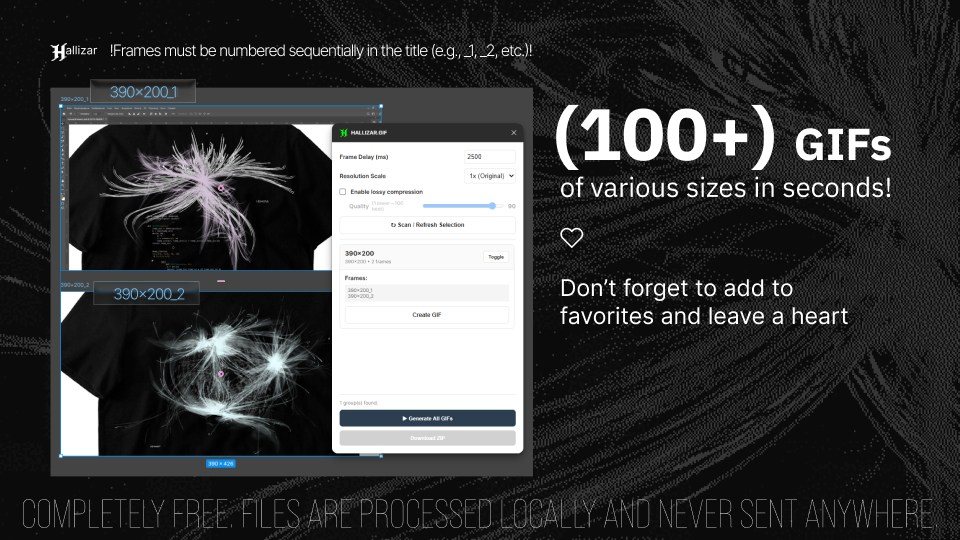
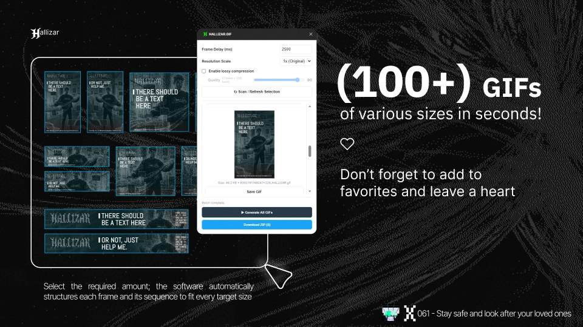

 

# HALLIZAR.GIF — Batch Animated GIF Generator for Figma

**Create high-quality animated GIFs directly from your Figma designs.**

HALLIZAR.GIF is a Figma plugin for generating animated GIFs from frames and grouped design elements. It streamlines repetitive export workflows by scanning your canvas, organizing animation sequences, and rendering individual or multiple GIF files from a single interface.

Free to use, open source, and designed for local processing.

## Features

### Batch Processing
- **Canvas scanning** — detect and collect eligible frames and groups from your Figma document.
- **Batch GIF generation** — process multiple animation sequences in one workflow.
- **Individual export** — generate and save a GIF for a selected sequence.
- **ZIP export** — download generated GIFs together in a single archive.

### Encoding and Output Control
- **Gifski-based encoding** — use the Gifski encoder compiled to WebAssembly for high-quality GIF output.
- **Frame timing** — configure frame delay to control animation playback speed.
- **Resolution scaling** — export at different scales to balance output dimensions and file size.
- **Quality optimization** — adjust available lossy compression settings to reduce file size when needed.
- **Preview** — inspect generated animations before saving them.

### Local Processing and Privacy
- **No account or activation required** — use the free version without a license key.
- **Local encoding** — GIF generation uses the encoder bundled with the plugin.
- **No frame uploads** — the plugin is designed to process document content locally rather than upload design frames to an external conversion service.
- **No external conversion service** — the GIF encoding engine is distributed with the plugin.

## How to Use

1. Open your Figma design file.
2. Select the frames or groups you want to use as animation sequences.
3. Launch **HALLIZAR.GIF** from the Figma plugins menu.
4. Click **Scan / Refresh Selection** to scan the current selection and identify available sequences.
5. Configure the frame delay, output scale, and compression quality.
6. Use **Create GIF** to render an individual sequence, or **Generate All GIFs** to process multiple sequences.
7. Preview the generated animations.
8. Save individual GIF files or download the complete batch as a ZIP archive.

*Exact results depend on the structure of your Figma document and the settings available in the current plugin version.*

## Technical Overview

HALLIZAR.GIF runs inside Figma and uses the plugin's document-access APIs to inspect design nodes and retrieve the content needed for rendering.

The GIF encoding pipeline uses **Gifski via WebAssembly (WASM)**, allowing the encoder to run within the plugin environment without requiring a separately installed native application.

The free release is configured for Figma's dynamic-page document access model.

Key implementation details:

- **Platform:** Figma Plugin API
- **Document access:** `dynamic-page`
- **Encoding engine:** Gifski
- **Runtime:** WebAssembly
- **Output format:** Animated GIF
- **Distribution model:** Free, open-source plugin

## Privacy

Your design files should remain under your control.

HALLIZAR.GIF is designed to perform frame processing and GIF encoding locally within the Figma plugin environment. It does not require an external GIF conversion service or a license-validation server.

The plugin's intended workflow does not upload design frames to a remote encoding service.

For complete technical details, including permissions and network-related configuration, refer to the source code in this repository.

## Open Source and Licensing

HALLIZAR.GIF is distributed under the **GNU Affero General Public License v3.0 (AGPL-3.0)**, subject to the terms of the repository's license file.

The project uses the following open-source components:

- **Gifski** — high-quality GIF encoder  
  https://github.com/ImageOptim/gifski
- **gifski-wasm** — WebAssembly integration for Gifski  
  https://github.com/jamsinclair/gifski-wasm

Please refer to the respective projects for their source code, license terms, and attribution requirements.

## Contributing

Contributions, bug reports, and suggestions are welcome.

If you encounter a problem with scanning, frame rendering, encoding, or exporting, please open an issue in the repository and include the steps needed to reproduce it.

**Repository:** https://github.com/Hallizar/HALLIZAR.GIF

---

**HALLIZAR.GIF**  
*Designed for creators. Built for batch production.*